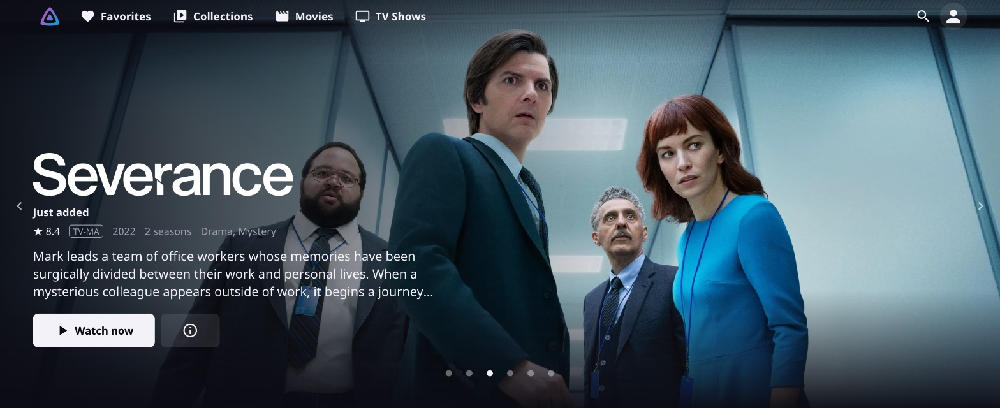
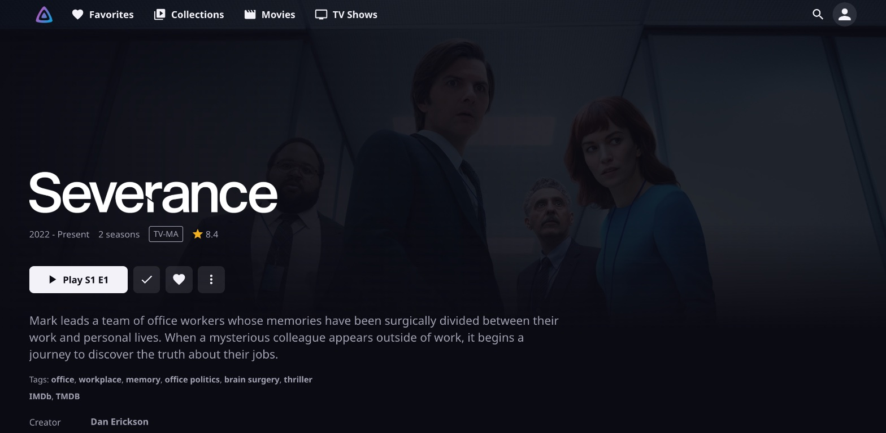
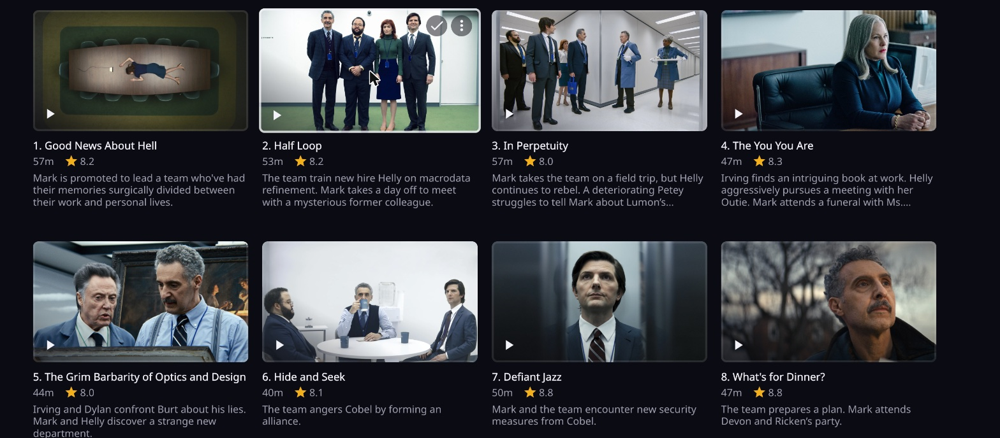
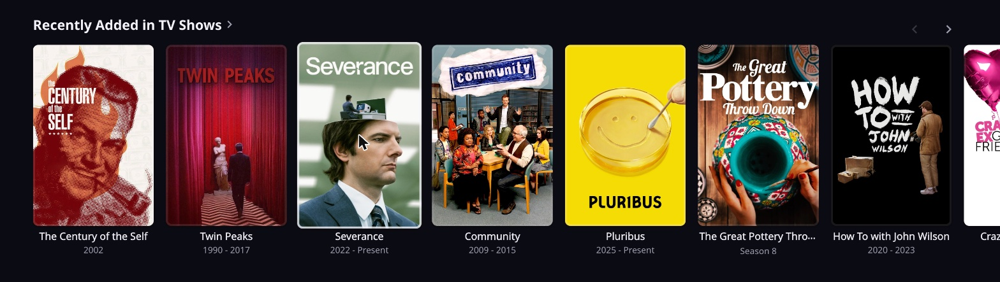

# Finoir

A dark, cinematic theme for the Jellyfin web client: a large hero banner that
drops straight into rows of content, quiet colours, and calm motion.

| | |
|---|---|
|  |  |

Built for **Jellyfin 12.2**, **Modern layout**, **Dark** theme. It uses only
supported extension points: the Custom CSS box and three small optional
scripts loaded through a plugin. No Jellyfin files are edited.

## What it changes

- **Colours.** Blue-black background, near-white text and buttons, a single
  violet accent used only for keyboard focus, the watched tick and markers.
- **Navigation bar.** Transparent at the top of a page, flat once scrolled;
  larger library links; no server name beside the logo.
- **Home.** A rotating hero banner (logo, audience and critics scores, age
  rating, year, length, genres, synopsis, *Watch now* and an info button),
  then tighter rows with bolder titles. It shows the newest films and shows,
  or the contents of a collection or playlist you name "Featured".
- **Cards.** Rounded corners, a faint border that brightens on hover, a slight
  lift. Continue Watching and Next Up cards play on click.
- **Detail pages.** Full-width backdrop with logo, facts and a labelled Play
  button at the bottom left; the large poster is hidden. With the detail
  script: the season count on series pages, no repeated text title under a
  logo, and a Play button that names the episode ("Play S1 E3").
- **Seasons.** Episodes shown as a grid of cards instead of a tall list.

## Install

### 1. The theme (CSS)

1. Open `css/theme.css` and copy all of it.
2. In Jellyfin go to **Dashboard → Branding → Custom CSS code**, paste, and
   save.
3. Reload the page with a hard refresh (Cmd/Ctrl + Shift + R).

This is enough for everything except the hero banner.

### 2. The scripts (optional, JavaScript)

Some things need item data or page state, which CSS cannot reach, so they are
small scripts. Each is independent; install only the ones you want.

| Script | What it adds | Asks the server for |
|---|---|---|
| `js/home-hero.js` | The hero banner on the home page | Two small item lists per page load, one logo per slide, one backdrop for the current and next slide |
| `js/detail-page.js` | Season count, logo-only titles, "Play S1 E3" label | The item's details once per page; the episode list on series pages |
| `js/nav-current.js` | An accent line under the library you are in | Nothing |

1. Install the **JavaScript Injector** plugin
   ([n00bcodr/Jellyfin-JavaScript-Injector](https://github.com/n00bcodr/Jellyfin-JavaScript-Injector))
   and restart Jellyfin.
2. Open **Dashboard → JS Injector**. For each script you want, add a script,
   paste the file's contents, enable it and tick the option to run it only
   for signed-in users.
3. Hard-refresh the page.

None of the scripts loads anything from outside your server. Settings are at
the top of each file.

**A "Featured" banner.** Create a collection or playlist called `Featured`
and the hero shows its films and shows instead of the newest ones (only items
that have a backdrop, a logo and a synopsis).

## Make it yours

Every colour, size and timing is a variable in the first block of
`css/theme.css` (section 1, "Tokens"). Change the look there; the rest of the
file only refers to those names. A few examples:

| Token | What it controls |
|---|---|
| `--bg`, `--surface`, `--text` | Base colours |
| `--accent` | Focus ring, watched tick |
| `--radius-card` | Corner radius of cards and buttons |
| `--hover-lift`, `--motion-card` | How far and how fast cards lift |
| `--nav-size`, `--nav-gap` | Navigation link size and spacing |

Settings for the hero (number of slides, time per slide, labels, the name of
the "Featured" list) are at the top of `js/home-hero.js`; the detail script
has an on/off switch for each of its three touches.

## Good to know

- The colours are scoped to Jellyfin's **Dark** theme. Choosing another theme
  under Settings → Display switches them off for that user.
- Jellyfin does not apply custom CSS to the admin dashboard, so that keeps its
  stock look.
- The detail-page layout and episode cards apply on desktop widths only;
  narrow screens keep Jellyfin's own layout.
- Hidden on purpose: Trailer and Shuffle on detail pages, the favourite button
  and "Ends at" on episode cards, and the SyncPlay and Cast buttons in the
  navigation bar. Each is a single clearly commented rule you can delete.
- The theme relies on Jellyfin's class names, which can change between
  releases. After a Jellyfin update, check the home page, a detail page, a
  season page and playback.

## Remove

- Theme: clear **Dashboard → Branding → Custom CSS code** and save.
- Scripts: switch them off in **Dashboard → JS Injector**, or uninstall the
  plugin.

## Licence

MIT. See [LICENSE](LICENSE).
